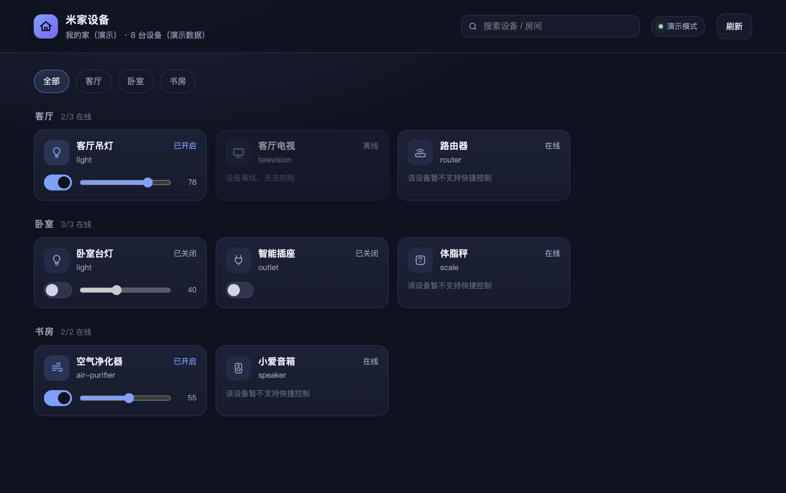

# dsh-miloco



把小米 **Miloco（米家）** 设备接入 **DeepSeek Harness**：一组 DSH 工具 + 一个本地控制面板。

- 工具：`miloco_status` / `miloco_devices` / `miloco_props` / `miloco_control` / `miloco_ui`
- UI：`http://127.0.0.1:5888/`（深色主题，按房间分组，灯/插座/净化器支持开关与亮度）
- 后端：复用本机 `miloco-cli`（不实现小米登录、不保存凭据）

## 依赖

1. 安装并登录 `miloco-cli`（`miloco-cli account bind`），后端服务在跑（`miloco-cli service status` 返回 `running: true`）；
2. Node.js ≥ 20；
3. DSH 桌面版（web profile）。

## 安装

```bash
# 1) 链接到 desktop profile
cd ~/.dsh/profiles/desktop
python3 - <<'PY'
import json
p='package.json'; d=json.load(open(p))
d.setdefault('dependencies',{})['dsh-miloco']='link:/path/to/dsh-miloco'
if 'dsh-miloco' not in d['dsh']['profile']['bundles']:
    d['dsh']['profile']['bundles'].append('dsh-miloco')
open(p,'w').write(json.dumps(d,ensure_ascii=False,indent=2))
PY
ln -sfn /path/to/dsh-miloco node_modules/dsh-miloco

# 2) ⌘Q 重启 DSH（插件只在启动时加载）
```

安装后在 DSH 里可以直接说「列出我的米家设备」「把台灯1打开」，或调用 `miloco_ui` 拿到面板地址。

## 工具

| 工具 | 作用 |
|---|---|
| `miloco_status` | 账号绑定与后端服务状态 |
| `miloco_devices` | 设备列表（名称/房间/类别/在线） |
| `miloco_props` | 读取设备属性（on/brightness/color-temperature） |
| `miloco_control` | 控制属性，**必须 `confirm=true`**，只允许 on/brightness/color-temperature/mode/toggle |
| `miloco_ui` | 启动/获取本地控制面板 URL |

## 安全边界

- 不实现小米登录协议、不保存凭据、不打印 token；
- 只允许白名单子命令与属性；
- 控制必须显式 `confirm=true`；
- UI 只监听 `127.0.0.1`，不对外暴露。

## UI 设计

- 参考 Home Assistant 的 dashboard 原则：卡片按状态着色、一个操作一个结果、只显示设备真正支持的控制、状态不对时如实变灰；
- 参考 NN/g 的智能设备可用性建议：打开即见所有设备状态、操作后立即反馈；
- 按房间分组、顶部搜索、在线计数、深色主题、移动端适配；
- **演示模式**：`http://127.0.0.1:5888/?demo=1` 用内置示例设备渲染（不含任何真实设备名/家庭信息），截图与文档统一用这个模式。

## 验证

```bash
npm test          # 4 个单测（解析/白名单/脱敏）
node scripts/verify-ui.mjs   # 起本地面板（127.0.0.1:5889）用真实设备验证
```

E2E 已在本机验证：读取 11 台设备、台灯1 `on=false→true→false` 往返、UI 渲染与开关/亮度。

## 边界

- 目前只做设备控制与状态读取；场景（scene）为空时不展示；
- 设备能力（亮度/色温）因型号而异，UI 只对 light/air-purifier 显示亮度；
- 不做摄像头/感知/身份库等 Miloco 高级能力（后续可扩展）。

## License

MIT
